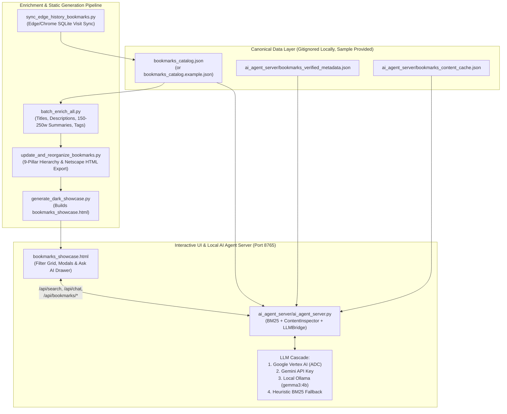

# 🔖 Curated Bookmarks & AI Knowledge Base (`organize-bookmarks`)

A zero-dependency Python knowledge management, taxonomy curation, and hybrid AI search platform for organizing engineering bookmarks into an interactive dark-mode showcase (`bookmarks_showcase.html`) backed by a local AI Copilot server (`ai_agent_server.py`).

---

## ✨ Key Capabilities

- **🏛️ 9-Pillar Strategic Taxonomy**: Automatically classifies and organizes bookmarks into a 2-level `[Pillar, Subcategory]` hierarchy with structured multi-dimensional tags (`products`, `topics`, `source_types`).
- **🎨 Interactive Dark Glassmorphism Showcase (`generate_dark_showcase.py`)**: Generates a single-file, responsive web application (`bookmarks_showcase.html`) featuring instant client-side filtering, pillar navigation, product scope chips, custom user notes, Add/Manage/Delete bookmark modals, and an integrated **Ask AI Copilot** drawer.
- **🤖 Zero-Dependency AI Agent Server (`ai_agent_server/ai_agent_server.py`)**: Pure Python standard-library `ThreadingHTTPServer` providing:
  - **Stage 1 — Intent Extraction**: Parses natural-language queries into structured product/topic/source filters via Google Vertex AI (`Gemini`), Gemini Developer API, local GPU `Ollama`, or a deterministic BM25/taxonomy heuristic fallback.
  - **Stage 2 — Hybrid BM25 + Taxonomy + Visit-Frequency Scoring**: Scores catalog entries across titles, descriptions, 150–250 word technical summaries, custom notes, and logarithmic browser visit counts.
  - **Stage 3 — Deep Content Verification & Grounded Synthesis**: Verifies candidate relevance against cached/extracted page content and generates a grounded technical answer citing `[1]`, `[2]`, etc.
- **🌐 Live Browser CDP Bookmark Ingestion**: Inspects newly added bookmarks via an active Chrome/Edge DevTools Protocol (CDP) session or `/browser` subagent payload—handling JavaScript SPAs, SSO sessions, and `#fragment` deep links—and updates the catalog + HTML outputs in a single step.
- **📊 Safe Browser History Visit Sync (`sync_edge_history_bookmarks.py`)**: Reads local Microsoft Edge and Google Chrome SQLite history databases (via temp copies to avoid file locks) to update `visit_count` rankings on existing curated bookmarks without injecting unverified history URLs.

---

## 🏗️ System Architecture



---

## 🚀 Quickstart

### Prerequisites
- **Python 3.9+** (uses Python standard library only; **zero external `pip` packages required**)
- *(Optional)* **Google Cloud SDK (`gcloud`)** for Vertex AI authentication, a `GEMINI_API_KEY`, or local **Ollama** (`ollama serve`) for generative AI synthesis. Without an LLM configured, the server automatically operates in deterministic BM25 + heuristic synthesis mode.

### 1. Clone the Repository
```bash
git clone https://github.com/dfs5/organize-bookmarks.git
cd organize-bookmarks
```

### 2. Initialize Local Configuration & Catalog (Optional)
Out of the box, all scripts automatically fall back to [`bookmarks_catalog.example.json`](bookmarks_catalog.example.json) (18 curated public technical bookmarks across all 9 pillars) and [`ai_agent_server/ai_agent_server.conf.example`](ai_agent_server/ai_agent_server.conf.example).

To create your own local catalog and server configuration (which are `.gitignore`d so your private bookmarks and project IDs stay local):
```bash
cp bookmarks_catalog.example.json bookmarks_catalog.json
cp ai_agent_server/ai_agent_server.conf.example ai_agent_server/ai_agent_server.conf
```
If using Google Vertex AI, set your GCP Project ID in `ai_agent_server/ai_agent_server.conf` (under `llm.gemini.project_id`) or export `GOOGLE_CLOUD_PROJECT`:
```bash
gcloud auth application-default login
export GOOGLE_CLOUD_PROJECT="your-gcp-project-id"
```

### 3. Build the Interactive Showcase HTML
```bash
python3 update_and_reorganize_bookmarks.py
python3 generate_dark_showcase.py
```
This generates:
- `bookmarks_showcase.html` — The interactive dark-theme web application.
- `favorites_product_frequency_organized.html` — Standard Netscape bookmark export importable into Chrome/Edge/Firefox.

### 4. Start the Local AI Agent Server
```bash
./run_ai_server.sh
./run_ai_server.sh --status
```
Open `bookmarks_showcase.html` in your browser to browse, filter, add/manage bookmarks, and query the **Ask AI Copilot** drawer (connected to `http://localhost:8765`).

---

## 🗂️ The 9 Canonical Strategic Pillars

| Pillar | Scope & Examples |
| :--- | :--- |
| **`01. BIG-IP & TMOS`** | LTM, APM, AWAF/ASM, DNS/GTM, iRules, F5OS-A (rSeries), F5OS-C (VELOS), iHealth, Hardware/VE Datasheets |
| **`02. NGINX Ecosystem`** | NGINX Open Source, NGINX Plus, NGINX One, NGINX App Protect (NAP), NGINX Ingress Controller, Gateway Fabric |
| **`03. F5 Distributed Cloud (XC) & Multi-Cloud`** | F5 XC Console, WAAP, Multi-Cloud Networking (MCN), DNS Load Balancer, CDN, Bot Defense, API Security |
| **`04. AI Security, Workforce AI & Agentic AI`** | F5 AI Gateway, AI Guardrails (CalypsoAI), Workforce AI Security (SurePath), Reference Architectures, Agentic AI |
| **`05. Knowledge Base (KBs) & Official TechDocs`** | MyF5 Knowledge Base (`K`-articles), CloudDocs, TechDocs, Product Manuals, Validated Architectures |
| **`06. Product Lifecycle, Releases & Roadmaps`** | Software Support Policies (`K5903`), Hardware/Software Compatibility Matrices (`K9476`), Release Notes, End-of-Life |
| **`07. Lab Environments, Demos & Developer Ecosystem`** | UDF Labs, Interactive Product Demos, GitHub Repositories, Terraform/Ansible/AS3 Automation, DevCentral Community |
| **`08. Internal Sales Engineering & Enablement`** | Solution Architectures, Industry Verticals, Sizing Tools, Competitive Enablement, Field Portals |
| **`09. External Engineering, Protocols & Tools`** | Kubernetes Docs, IETF RFCs, OWASP, TLS/SSL Utilities, Cloud Provider Documentation, Network/Security Tools |

---

## 🛠️ Common Operations & CLI Commands

### AI Agent Server Lifecycle
```bash
./run_ai_server.sh                   # Start background daemon on port 8765
./run_ai_server.sh --status          # Check server health, active LLM backend, and logging state
./run_ai_server.sh --restart         # Restart after config or catalog changes
./run_ai_server.sh --stop            # Stop background daemon
./run_ai_server.sh --enable-logging  # Enable full Frontend <-> Server <-> LLM traffic logging
./run_ai_server.sh --tail-log        # Follow live traffic in ai_agent_server/ai_communication.log
./run_ai_server.sh --disable-logging # Disable traffic logging
```

### Command-Line Bookmark Lookup
```bash
python3 .agents/skills/bookmark-lookup/lookup.py "rseries sizing"
python3 .agents/skills/bookmark-lookup/lookup.py --product f5-xc --topic security-waf
```

### Canonical CLI Bookmark Ingestion
```bash
python3 ai_agent_server/ai_agent_server.py \
  --ingest-url "https://docs.nginx.com/" \
  --browser-json '{"title":"F5 NGINX Product Documentation","h1":"F5 NGINX Documentation","meta_desc":"Official documentation for NGINX products.","company_context":"F5 NGINX application delivery and API security","body_text":"..."}' \
  --notes "Core NGINX documentation portal"
```

### Browser History Visit Sync
```bash
python3 sync_edge_history_bookmarks.py --dry-run --show-candidates
python3 sync_edge_history_bookmarks.py
```

---

## 📚 Documentation Index

- [**Project Maintenance Guide (`MAINTENANCE.md`)**](MAINTENANCE.md) — Quick reference for server commands, showcase rebuilds, and persistent session memory.
- [**AI Agent Server Maintenance Guide (`ai_agent_server/MAINTENANCE.md`)**](ai_agent_server/MAINTENANCE.md) — Deep dive into `ai_agent_server.conf`, health checks, LLM provider cascading, traffic logging, and troubleshooting.
- [**Agent Rules & Code Map (`AGENTS.md`)**](AGENTS.md) — Context guardrails, canonical data schema, `/browser` inspection workflow, and line-level code index.
- **Architecture & Workflow Deep Dives (`docs/`)**:
  - [**Complete Project Architecture (`docs/demo-bookmark-project-human-readable.md`)**](docs/demo-bookmark-project-human-readable.md) *(and [detailed reference](docs/demo-bookmark-project.md))*
  - [**Adding a Bookmark End-to-End Trace (`docs/demo-adding-bookmark-human-readable.md`)**](docs/demo-adding-bookmark-human-readable.md) *(and [detailed trace](docs/demo-adding-bookmark.md))*
  - [**Searching Bookmarks & AI Copilot Trace (`docs/demo-searching-bookmarks-human-readable.md`)**](docs/demo-searching-bookmarks-human-readable.md) *(and [detailed trace](docs/demo-searching-bookmarks.md))*
