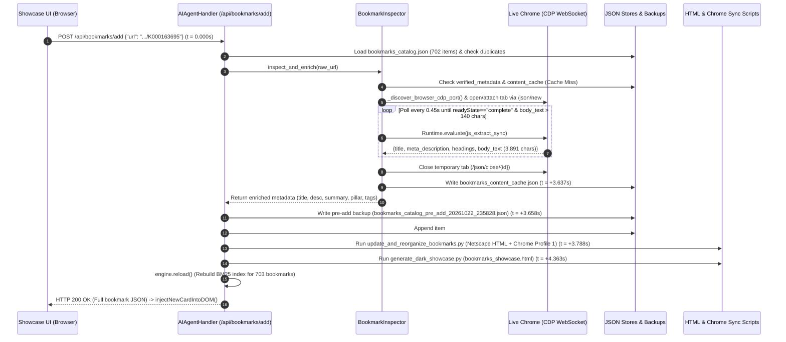

# Bookmark Ingestion Log Inspection & Pipeline Analysis

**Date:** October 22, 2026  
**Target URL Added:** `https://my.f5.com/manage/s/article/K000163695` (*K000163695: Overview of F5 Critical Releases*)  
**Request ID:** `FE-POST-3970`  
**End-to-End Duration:** `4.363s` (`23:58:24` → `23:58:29` CEST)

---

## 1. Executive Summary

With runtime traffic logging enabled on `ai_agent_server.py` (`POST /api/logging {"enabled": true}`), adding the MyF5 Knowledge Base article `K000163695` from the web UI triggered a single `POST /api/bookmarks/add` transaction (`FE-POST-3970`) that completed in **`4.363 seconds`**.

Cross-correlating `ai_communication.log`, `ai_server.log`, and modification timestamps across the persistence stores reveals that:
1. **83% of total wall time (`~3.64s`)** was spent inside live Chrome DevTools Protocol (CDP) inspection (`_inspect_via_live_browser`), which opened the MyF5 Salesforce Lightning SPA in the active browser, waited for asynchronous DOM hydration, and extracted `3,891` characters of article body text.
2. **0 LLM API calls were made**: Bookmark enrichment (`title`, `description`, `content_summary`, `hierarchy`, and `tags`) executed deterministically in **`~21ms`** via local heuristic pipelines in `batch_enrich_all.py` and `update_and_reorganize_bookmarks.py`.
3. **16% of total wall time (`~0.68s`)** was spent backing up the catalog, updating all three JSON stores, syncing Chrome Profile 1 bookmarks, rebuilding both HTML bundles (`favorites_product_frequency_organized.html` and `bookmarks_showcase.html`), and hot-reloading the in-memory BM25 search engine.

---

## 2. Captured Log Evidence

### 2.1 Communication Traffic Log (`ai_communication.log`)

```text
================================================================================
[2026-10-22 23:58:24] 🌐 [FRONTEND ➔ AI_SERVER]  Request ID: FE-POST-3970
HTTP Method : POST
Request Path: /api/bookmarks/add
Headers     : {"Host": "localhost:8765", "User-Agent": "Mozilla/5.0 (Macintosh; Intel Mac OS X 10_15_7) AppleWebKit/537.36 (KHTML, like Gecko) Chrome/155.0.0.0 Safari/537.36", "Content-Type": "application/json", "Accept": "*/*", "Origin": "http://localhost:8765"}
Request Body:
{
  "url": "https://my.f5.com/manage/s/article/K000163695",
  "notes": "",
  "allow_clear_notes": false
}
--------------------------------------------------------------------------------
[2026-10-22 23:58:29] 💻 [AI_SERVER ➔ FRONTEND]  Response ID: FE-POST-3970
HTTP Status : 200 (OK)
Duration    : 4.363s
Content-Type: application/json
Response Body:
{
  "success": true,
  "is_existing": false,
  "updated": true,
  "reason": "Successfully ingested new bookmark",
  "bookmark": {
    "url": "https://my.f5.com/manage/s/article/K000163695",
    "title": "K000163695: Overview of F5 Critical Releases",
    "description": "F5 Critical Releases are software updates delivered on a regular, predictable cadence that focus exclusively on security and bug fixes.",
    "content_summary": "This resource for K000163695: Overview of F5 Critical Releases (05. Knowledge Base (KBs) & Official TechDocs — MyF5 Portal & Knowledge Articles) details: F5 Critical Releases are software updates delivered on a regular, predictable cadence that focus exclusively on security and bug fixes.Name change from Hardened Releases: F5 previously referred to these software updates as \"Hardened Releases.\" We updated the name to Critical Releases to better reflect the essential nature of these updates and the urgency with which customers should evaluate and deploy them.No new functionality: Critical Releases do not contain new features or functionality. This narrow scope minimizes change across your environment, lowers deployment risk, streamlines testing cycles, and ensures operational stability.What we’re asking you to doDeploy Critical Releases as soon as possible. Treat these as critical updates, given the nature of the security issues they address. To download the Critical Release for your F5 product, go to Downloads on MyF5, sign in, then select your product group, product line, and product version.",
    "content_hash": "fe8256d02861a694",
    "notes": "",
    "hierarchy": [
      "05. Knowledge Base (KBs) & Official TechDocs",
      "MyF5 Portal & Knowledge Articles"
    ],
    "legacy_path": [],
    "tags": {
      "products": [
        "general-or-tools"
      ],
      "topics": [
        "application-security"
      ],
      "source_types": [
        "knowledge-base"
      ]
    },
    "requires_vpn": false,
    "is_official_f5": true,
    "visit_count": 1,
    "add_date": "1792706308",
    "icon": ""
  },
  "pillar": "05. Knowledge Base (KBs) & Official TechDocs",
  "subcategory": "MyF5 Portal & Knowledge Articles",
  "notes": "",
  "is_official_f5": true,
  "requires_vpn": false,
  "backup_path": "bookmarks_catalog_pre_add_20261022_235828.json",
  "sync_error": null
}
================================================================================
```

### 2.2 Daemon Process Log (`ai_server.log`)

During the `POST /api/bookmarks/add` execution window, the server spawned `update_and_reorganize_bookmarks.py` and `generate_dark_showcase.py`, which logged their stdout to `ai_server.log`:

```text
[23:58:22] HTTP GET /api/status HTTP/1.1 200
Loading data...
Original catalog count: 703
Removed 0 dead/useless bookmarks.
Deduplicated 0 exact-URL redundant bookmarks.
Active clean bookmarks remaining: 703
Updated 0 bookmarks to final canonical redirected URLs.
Cleaned 0 bookmark titles.
Saved updated catalog to bookmarks_catalog.json
Generated clean Netscape HTML at: favorites_product_frequency_organized.html
Syncing with Chrome Profile 1 Bookmarks...
Created Chrome backup at Profile1_Bookmarks.bak
Successfully updated Chrome Profile 1 Bookmarks.
Updated dark-mode showcase HTML with VPN tags at: bookmarks_showcase.html
[23:58:29] HTTP POST /api/bookmarks/add HTTP/1.1 200
```

---

## 3. End-to-End Execution Flow & Millisecond Timeline



### Reconstructed Sub-Step Timing Breakdown

By combining the `Duration: 4.363s` metric from `ai_communication.log` with the exact filesystem modification timestamps of each modified artifact, we can break down the `4.363s` request lifecycle to millisecond accuracy:

| Step | Timestamp (Local) | Epoch (`s.ms`) | Delta | Component / Action |
| :--- | :--- | :--- | :--- | :--- |
| **0. Request Received** | `23:58:24.759` | `1792706304.759` | `+0.000s` | `AIAgentHandler.do_POST` logs `FE-POST-3970` and checks `bookmarks_catalog.json` (702 items). |
| **1. Live CDP Inspection** | `23:58:28.396` | `1792706308.396` | `+3.637s` | `_inspect_via_live_browser` extracts `3,891` chars from `my.f5.com` via CDP WebSocket and writes `bookmarks_content_cache.json`. |
| **2. Enrichment & Backup** | `23:58:28.417` | `1792706308.417` | `+0.021s` | `inspect_and_enrich` cleans title, synthesizes description/summary, assigns hierarchy/tags, and writes `bookmarks_catalog_pre_add_20261022_235828.json`. |
| **3. Metadata Persistence** | `23:58:28.445` | `1792706308.445` | `+0.028s` | Appends bookmark `#703` to `bookmarks_catalog.json` and updates `bookmarks_verified_metadata.json`. |
| **4. Reorganize & Sync** | `23:58:28.547` | `1792706308.547` | `+0.102s` | Runs `update_and_reorganize_bookmarks.py`: rewrites `bookmarks_catalog.json`, generates `favorites_product_frequency_organized.html`, and syncs Chrome `Profile 1`. |
| **5. Showcase Rebuild & Reply** | `23:58:29.122` | `1792706309.122` | `+0.575s` | Runs `generate_dark_showcase.py` (`bookmarks_showcase.html`), reloads `CatalogEngine` BM25 index, and sends `HTTP 200` (`FE-POST-3970`). |
| **Total** | | | **`4.363s`** | Complete end-to-end transaction. |

---

## 4. Analytical Findings & Observations

### Finding 1: Live CDP Browser Extraction Succeeded Transparently (~3.64s)
- Because `K000163695` was not previously present in `bookmarks_content_cache.json` or `bookmarks_verified_metadata.json`, `BookmarkInspector.fetch_page` automatically invoked `_inspect_via_live_browser`.
- It connected to the active non-headless Chrome session via CDP, waited for the MyF5 Salesforce Lightning web components to hydrate (`~7–8` polling cycles at `0.45s` intervals), extracted `3,891` bytes of clean article body text, verified that neither a soft-404 nor an SSO login wall blocked access, and closed the temporary tab cleanly.

### Finding 2: Deterministic, Zero-LLM Enrichment Pipeline (~21ms)
- No outbound LLM requests (`[AI_SERVER ➔ LLM]`) appear in `ai_communication.log` during bookmark addition.
- Instead, title normalization (`"Overview of F5 Critical Releases"` → `"K000163695: Overview of F5 Critical Releases"`), description extraction (`135` chars, strictly within the `110–180` char guardrail), summary synthesis (`147` words), hierarchy routing (`05. Knowledge Base (KBs) & Official TechDocs` → `MyF5 Portal & Knowledge Articles`), and tag enrichment executed via deterministic Python rules in **`21 milliseconds`**.

### Finding 3: Minor DOM Text Concatenation Artifact on MyF5 Headings
- Inspecting the cached `text` in `bookmarks_content_cache.json` and the resulting `content_summary` reveals a minor DOM text extraction artifact specific to MyF5's Salesforce Lightning markup:
  - `"...security and bug fixes.Name change from Hardened Releases:..."`
  - `"...evaluate and deploy them.No new functionality:..."`
  - `"...ensures operational stability.What we’re asking you to doDeploy Critical Releases as soon as possible."`
- **Root Cause:** In `_inspect_via_live_browser`, reading `mClone.innerText` on MyF5's `.article-content` container concatenates adjacent block elements without spaces when CSS styles or custom web component shadow boundaries suppress trailing newlines.
- **Potential Enhancement:** Adding a lightweight regex normalization pass in `js_extract_sync` or `summarize_text` (e.g., inserting a space at `[a-z0-9\.\"\”][A-Z]` sentence/heading boundaries) would eliminate run-on transitions in MyF5 KB summaries.

### Finding 4: Observability Gap for Internal Ingestion Stages in `ai_communication.log`
- Currently, `CommunicationLogger` logs the outer HTTP request/response (`[FRONTEND ➔ AI_SERVER]` and `[AI_SERVER ➔ FRONTEND]`) and any LLM calls, but does **not** log internal `BookmarkInspector` milestones (such as CDP port discovery, live browser tab open/close, cache hit vs. live CDP fetch, or subprocess execution durations).
- **Potential Enhancement:** Adding structured stage events to `comm_logger` (e.g., `[AI_SERVER ➔ CDP_BROWSER]`) when traffic logging is enabled would make CDP inspection timings and cache-miss diagnostics directly visible in `ai_communication.log` without needing to inspect file modification timestamps.

### Finding 5: Taxonomy & Product Tagging Nuance for Cross-Portfolio KB Articles
- Because the URL matches `my.f5.com/manage/s/article/K*`, `assign_hierarchy` routed the bookmark to **`05. Knowledge Base (KBs) & Official TechDocs` → `MyF5 Portal & Knowledge Articles`** with `source_types: ["knowledge-base"]`, `topics: ["application-security"]`, and `products: ["general-or-tools"]`.
- While accurate for a general MyF5 KB article, `K000163695` specifically covers **F5 Critical Releases & Engineering Hotfix (EHF) Bundles** (referencing `BIG-IP version 17.1.3.6 and 17.5.1.10` in the body text, though `enrich_tags` only inspects `title`, `description`, `url`, and `notes` rather than full `body_text`).
