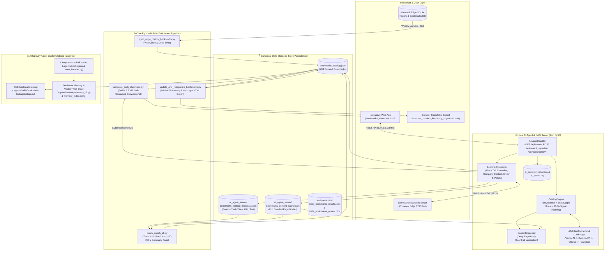
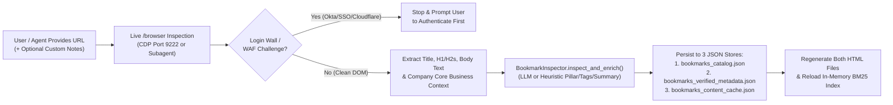

# 🏛️ Architecture & Workflows Guide: F5 & Cloud Bookmarks Intelligence Platform (`organize-bookmarks`)

This document provides a complete architectural and operational overview of the **Bookmarks Intelligence Platform** (`organize-bookmarks`) — how the interactive showcase website, data stores, enrichment pipelines, local AI Agent Server, browser history synchronization, and Antigravity AI agent memory/skill subsystems are built and how their workflows operate together.

> **Companion Runtime Deep-Dives:**
> - 📥 [**Adding a Bookmark Runtime Analysis (`demo-adding-bookmark.md`)**](demo-adding-bookmark.md) — Line-by-line trace of live `/browser` CDP inspection, heuristic/LLM enrichment, 3-store persistence, and HTML regeneration (`FE-POST-3970`).
> - 🔍 [**Searching via Ask AI Copilot Runtime Analysis (`demo-searching-bookmarks.md`)**](demo-searching-bookmarks.md) — Line-by-line trace of Vertex AI intent extraction, hybrid BM25 + product-scope retrieval, deep page-content verification, and grounded answer synthesis (`FE-POST-4037`, `LLM-4038`, `LLM-4039`).

---

## 1. High-Level System Architecture

The platform is built around a **Single Source of Truth JSON Catalog** ([`bookmarks_catalog.json`](../bookmarks_catalog.json)) backed by two ground-truth page caches, a static-yet-interactive **Dark Showcase Web Application** ([`bookmarks_showcase.html`](../bookmarks_showcase.html)), a local **AI Agent & RAG HTTP Server** ([`ai_agent_server/ai_agent_server.py`](../ai_agent_server/ai_agent_server.py)), an automated **Edge Browser History Sync pipeline**, and a **Two-Tier Persistent Agent Memory & Context Guardrail system**.



---

## 2. Canonical Data Layer & 9-Pillar Taxonomy

### 2.1 The Three Synchronized JSON Data Stores
Every bookmark in the system is persisted and cross-referenced across three JSON stores:

| Store File | Size | Role & Contents |
| :--- | :--- | :--- |
| [`bookmarks_catalog.json`](../bookmarks_catalog.json) | `~1.9 MB` | **Single Source of Truth (`703` bookmarks).** List of rich bookmark objects containing `url`, `previous_url`, `title`, `description` (110–180 chars), `content_summary` (150–250 words), `notes` (custom user notes), `hierarchy` (`[Pillar, Subcategory]`), `tags` (`products`, `topics`, `source_types`), `visit_count`, `add_date`, `requires_vpn`, `is_official_f5`, and base64 `icon`. |
| [`ai_agent_server/bookmarks_verified_metadata.json`](../ai_agent_server/bookmarks_verified_metadata.json) | `~2.1 MB` | **Ground-Truth Inspection Store.** Dictionary keyed by URL storing the raw extracted `<title>`, `h1`, `h2` headings, meta description, `company_context` (brand/core business discovery), `body_snippet`, and `inspected_via: "/browser"`. Used by [`batch_enrich_all.py`](../batch_enrich_all.py) to deterministically rebuild summaries without re-scraping. |
| [`ai_agent_server/bookmarks_content_cache.json`](../ai_agent_server/bookmarks_content_cache.json) | `~4.1 MB` | **Full-Text Search Verification Cache.** Dictionary keyed by URL containing up to `12,000` characters of clean rendered body text (`text`), `title`, `status`, and `timestamp`. Used at query time by [`ContentInspector.verify_candidates`](../ai_agent_server/ai_agent_server.py#L745-L779) to verify that candidate bookmarks actually contain mandatory query keywords. |

### 2.2 The 9 Canonical Strategic Pillars (`hierarchy[0]`)
All bookmarks are organized into a strict 2-level hierarchy (`[Pillar, Subcategory]`):
1. **`01. BIG-IP & TMOS`** — LTM, APM, AWAF/ASM, DNS/GTM, rSeries (`F5OS-A`), VELOS (`F5OS-C`), BIG-IQ, iRules, AS3/Declarative Automation, and TMOS Sizing/Performance.
2. **`02. NGINX Ecosystem`** — NGINX Plus, NGINX One, NGINX App Protect (NAP), Kubernetes Ingress / Gateway API, and NJS.
3. **`03. F5 Distributed Cloud (XC) & Multi-Cloud`** — WAAP, Multi-Cloud Networking (MCN), App Connect, CDN, Bot Defense, and AWS/Azure/GCP/OpenShift reference architectures.
4. **`04. AI Security, Workforce AI & Agentic AI`** — F5 AI Gateway, F5 Workforce AI Security (SurePath AI), AI Guardrails (CalypsoAI), LLM/GenAI Reference Architectures, and External Industry AI Innovations.
5. **`05. Knowledge Base (KBs) & Official TechDocs`** — AskF5 / MyF5 Support Articles (`K`-numbers), CloudDocs, TechDocs, and Security Advisories (SIRT/CVEs).
6. **`06. Product Lifecycle, Releases & Roadmaps`** — Software Lifecycle/EoL/EoS Policies, Compatibility Matrices, Hardware Datasheets, and Aha! Ideas Portals.
7. **`07. Lab Environments, Demos & Developer Ecosystem`** — UDF Blueprints, GitHub/GitLab Demo Repositories, DevCentral Articles, and Postman/API Collections.
8. **`08. Internal Sales Engineering & Enablement`** — SupportNet, Highspot, SharePoint, ServiceNow, Tableau/Salesforce Dashboards, and Competitive Intelligence.
9. **`09. External Engineering, Protocols & Tools`** — RFCs, SSL/TLS/PKI Tools, Public Cloud/Linux/Networking Guides, and External Public Portals.

### 2.3 Multi-Dimensional Tag Taxonomy (`tags`)
Every bookmark carries structured arrays across three orthogonal dimensions configured in [`ai_agent_server/ai_agent_server.conf`](../ai_agent_server/ai_agent_server.conf#L110-L146):
- **`products`:** `big-ip`, `rseries`, `velos`, `nginx`, `f5-xc`, `f5-ai-gateway`, `f5-workforce-ai-security`, `ai-guardrails`, `public-cloud`, `ai-workloads`.
- **`topics`:** `sizing-capacity`, `access-identity`, `security-waf`, `traffic-ssl`, `dns-gtm`, `releases-lifecycle`, `automation-devops`, `kubernetes-containers`, `programmability-irules`, `troubleshooting-kbs`, `performance-optimization`.
- **`source_types`:** `kb-article`, `techdocs`, `github-repo`, `devcentral`, `dashboard`, `internal-portal`, `roadmap-ideas`, `sizing-tool`.

---

## 3. Core Components & Scripts Breakdown

### 3.1 Interactive Dark Showcase Generator ([`generate_dark_showcase.py`](../generate_dark_showcase.py) → [`bookmarks_showcase.html`](../bookmarks_showcase.html))
- **Role:** Compiles [`bookmarks_catalog.json`](../bookmarks_catalog.json) into a single, self-contained `3.7 MB` dark-mode web application ([`bookmarks_showcase.html`](../bookmarks_showcase.html)) that works both as a `file://` local page and when served over HTTP (`http://localhost:8765/bookmarks_showcase.html`).
- **Key Features Built into `generate_dark_showcase.py` (`3,746 lines`):**
  - **Sticky Frosted-Glass Top Shell (`L34–L533`):** Sticky header and search/filter bar (`backdrop-filter: blur(16px)`) with instant client-side filtering by Pillar, Product tag, Topic tag, Source Type, VPN status (`Public` vs. `VPN Required`), Official F5 badge, and minimum visit count.
  - **Rich Bookmark Cards (`render_card`, `L534–L856`):** Displays cleaned title, 110–180 char grammatical description, visit count badge, VPN/Official F5 badges, custom user notes editor (`📝 Add/Edit Note`), product/topic/source pills, and a hidden `150–250` word `.card-summary-hidden` block indexed for instant client-side search.
  - **Recently Added Section:** Highlights the most recently added bookmarks at the top of the page.
  - **Interactive Add Bookmark Modal (`L2551–L2800`):** Allows pasting a URL and optional custom notes (`#add-bm-url-input`, `#add-bm-notes-input`), triggers `POST http://127.0.0.1:8765/api/bookmarks/add`, displays an animated 3-step progress pipeline (*Step 1: Live `/browser` Inspection*, *Step 2: AI Categorization & Enrichment*, *Step 3: Saving & Rebuilding*), and dynamically injects the newly created card into the live DOM (`injectNewCardIntoDOM`) without a page reload.
  - **Manage & Bulk Delete Mode (`L2235–L2455`):** Toggleable management mode with checkbox selection (using document-level event delegation) and a confirmation modal calling `POST /api/bookmarks/delete`.
  - **Embedded Ask AI Copilot Drawer (`L3069–L3746`, shortcut `⌘K`):** Slide-out conversational AI assistant with **Product Scope selector pills** (*All Products*, *BIG-IP & TMOS*, *NGINX*, *F5 Distributed Cloud*, *AI Security*, *rSeries / VELOS*), live backend health indicator (`probeServer`), Markdown answer rendering, verified bookmark citation cards with **"Locate on Page"** auto-scroll/highlight (`locateCardOnPage`), and automatic fallback to client-side BM25 search (`clientFallbackSearch`) if the backend server is offline.

### 3.2 Taxonomy & Netscape Bookmark Exporter ([`update_and_reorganize_bookmarks.py`](../update_and_reorganize_bookmarks.py))
- **Role (`730 lines`):**
  - Normalizes and cleans raw bookmark titles (`clean_title`, `L39–L181`), stripping noisy prefixes/suffixes (`"AskF5 | "`, `"MyF5 | "`, excess pipes, and URL fragments).
  - Deterministically assigns every bookmark to its `[Pillar, Subcategory]` (`assign_hierarchy`, `L191–L400`) based on domain, URL path, K-number patterns, and product/topic keywords.
  - Validates redirects (`is_valid_redirect`, `L410–L430`) to prevent Khoros/DevCentral `/t5/` redirect traps.
  - Exports [`favorites_product_frequency_organized.html`](../favorites_product_frequency_organized.html) (`365 KB`), a standard `NETSCAPE-Bookmark-file-1` HTML file sorted by pillar, subcategory, and historical visit frequency that can be imported directly into Chrome, Edge, Safari, or Firefox.

### 3.3 Deep Metadata & Summary Enrichment Engine ([`batch_enrich_all.py`](../batch_enrich_all.py))
- **Role (`1,379 lines`):**
  - Reads ground-truth page extractions from [`ai_agent_server/bookmarks_verified_metadata.json`](../ai_agent_server/bookmarks_verified_metadata.json) and [`ai_agent_server/bookmarks_content_cache.json`](../ai_agent_server/bookmarks_content_cache.json).
  - Generates clean, human-readable card titles (`clean_card_title`, `L88–L165`) and complete grammatical card descriptions (`format_clean_description`, `L167–L239`, targeting `110–180` characters without mid-clause truncation).
  - Synthesizes rich `150–250` word technical summaries (`_generate_domain_summary_raw`, `L479–L982`) that ground each page's core content within its company/brand core business context and F5 architectural domain.
  - Enriches multi-dimensional `tags` (`enrich_tags`, `L984–L1144`) so product, topic, and source-type tags strictly align with the assigned Strategic Pillar and Subcategory.

### 3.4 Microsoft Edge Browser History & Bookmark Sync ([`sync_edge_history_bookmarks.py`](../sync_edge_history_bookmarks.py))
- **Role (`386 lines`):**
  - Safely copies the locked Microsoft Edge SQLite `History` database (`~/Library/Application Support/Microsoft Edge/Default/History`) to a temporary file and queries `urls.visit_count` and `last_visit_time`.
  - Reads Edge's `Bookmarks` JSON file to detect newly bookmarked URLs in the browser.
  - Updates `visit_count` across [`bookmarks_catalog.json`](../bookmarks_catalog.json) and triggers HTML regeneration.
  - Automated weekly via macOS `launchd` ([`com.f5.bookmarks.sync.plist.example`](../com.f5.bookmarks.sync.plist.example) → [`run_sync_standalone.sh`](../run_sync_standalone.sh), every Monday at `09:00`).

---

## 4. Local AI Agent & RAG Server ([`ai_agent_server/ai_agent_server.py`](../ai_agent_server/ai_agent_server.py))

The backend server (`3,222 lines`, listening on `http://0.0.0.0:8765`, managed via [`run_ai_server.sh`](../run_ai_server.sh)) powers live bookmark inspection, hybrid BM25 + LLM search, and conversational synthesis.

### 4.1 Internal Server Modules

| Class / Component | Line Range | Responsibility |
| :--- | :--- | :--- |
| **`load_config` & Vertex Helpers** | [`L35–L209`](../ai_agent_server/ai_agent_server.py#L35-L209) | Parses JSON-with-comments from [`ai_agent_server.conf`](../ai_agent_server/ai_agent_server.conf) and maps friendly model names (e.g., `"Gemini 3.8 Flash (Medium)"`) to Vertex AI publisher endpoints (`gemini-2.5-flash`). |
| **`CommunicationLogger`** | [`L215–L416`](../ai_agent_server/ai_agent_server.py#L215-L416) | Runtime-toggleable traffic logger (`ai_communication.log`) capturing `FE -> SERVER`, `SERVER -> LLM`, `LLM -> SERVER`, and `SERVER -> FE` payloads with automatic OAuth2 Bearer token and API key redaction. |
| **`GoogleAuthHelper` & `send_llm_request`** | [`L429–L552`](../ai_agent_server/ai_agent_server.py#L429-L552) | Resolves Google Cloud Application Default Credentials (ADC) Bearer tokens and Project IDs (`<YOUR_GCP_PROJECT_ID>`) and wraps outbound LLM HTTP requests with correlation IDs (`LLM-xxxx`). |
| **`ContentInspector`** | [`L554–L808`](../ai_agent_server/ai_agent_server.py#L554-L808) | Verifies top BM25 candidates against full cached page text (`bookmarks_content_cache.json`), enforcing `must_mention` lexical guardrails and computing `content_boost` (`-15.0` to `+55.0`). |
| **`LLMIntentExtractor`** | [`L812–L1121`](../ai_agent_server/ai_agent_server.py#L812-L1121) | Zero-shot structured JSON query analyzer (`is_migration`, `target_products`, `target_topics`, `search_keywords`, `must_mention`, `summary`) with a 4-tier cascade: **Vertex AI → Gemini API → Local Ollama (`gemma3:4b`) → Heuristic Taxonomy**. |
| **`CatalogEngine`** | [`L1124–L1431`](../ai_agent_server/ai_agent_server.py#L1124-L1431) | Builds the in-memory BM25 index (`k1=1.5, b=0.75`) over titles (`3x`), descriptions, summaries, notes (`3x`), URL paths, hierarchy (`2x`), and tags (`3x`), and executes hybrid multi-signal search. |
| **`LLMBridge`** | [`L1434–L1695`](../ai_agent_server/ai_agent_server.py#L1434-L1695) | Grounded RAG answer synthesizer that injects product scope rules and the top 8 verified bookmarks into Vertex AI / Gemini / Ollama (or produces a structured heuristic summary if offline). |
| **`BookmarkInspector`** | [`L1828–L2626`](../ai_agent_server/ai_agent_server.py#L1828-L2626) | Discovers the live Chrome/Edge CDP port (`_discover_browser_cdp_port`), evaluates DOM extraction over raw WebSockets (`_cdp_ws_eval`), discovers company core business context (`_discover_company_context`), detects SSO login walls or Cloudflare/Imperva challenges, enriches metadata (`inspect_and_enrich`), and persists to all 3 stores + rebuilds HTML (`ingest_and_persist`). |
| **`AIAgentHandler`** | [`L2658–L3222`](../ai_agent_server/ai_agent_server.py#L2658-L3222) | REST API HTTP handler and CLI entrypoint (`--ingest-url`, `--update-notes`). |

### 4.2 HTTP REST API Reference

| Method & Endpoint | Purpose | Key Request / Response Fields |
| :--- | :--- | :--- |
| `GET /api/status` | Health check, catalog size, active LLM provider, and logging status | Returns `status`, `bookmarks_count`, `llm_backend`, `intent_engine`, `traffic_logging`. |
| `POST /api/chat` | **Ask AI Copilot** full RAG pipeline (Intent → BM25 + Scope → Content Verification → LLM Synthesis) | Request: `{"query", "product_scope", "filters", "history"}` → Response: `{"synthesis", "results", "intent", "provider"}`. |
| `POST /api/search` | Structured hybrid BM25 + Content Verification search (without LLM chat synthesis) | Request: `{"query", "product_scope", "filters", "limit"}` → Response: `{"results", "intent", "total"}`. |
| `POST /api/bookmarks/add` | Live `/browser` CDP inspection, enrichment, 3-store persistence, and showcase HTML rebuild | Request: `{"url", "notes", "browser_extracted"}` → Response: `{"status": "created"\|"updated", "bookmark", "catalog_total"}`. |
| `POST /api/bookmarks/notes` | Updates custom user `notes` on an existing bookmark across catalog, BM25 index, and HTML | Request: `{"url", "notes"}` → Response: `{"status": "updated", "bookmark"}`. |
| `POST /api/bookmarks/delete` | Bulk-deletes selected bookmarks from `bookmarks_catalog.json` and regenerates HTML | Request: `{"urls": [...]}` → Response: `{"status": "deleted", "deleted_count", "remaining_count"}`. |
| `POST /api/logging` | Dynamically toggles `CommunicationLogger` (`ai_communication.log`) at runtime without restart | Request: `{"enabled": true\|false}` → Response: `{"traffic_logging", "log_file"}`. |

---

## 5. Antigravity Agent Customizations & Context-Protection Architecture

Because this repository contains multi-megabyte data and HTML bundles ([`bookmarks_showcase.html`](../bookmarks_showcase.html) at `3.7 MB`, [`bookmarks_content_cache.json`](../ai_agent_server/bookmarks_content_cache.json) at `4.1 MB`, [`bookmarks_verified_metadata.json`](../ai_agent_server/bookmarks_verified_metadata.json) at `2.1 MB`, and [`bookmarks_catalog.json`](../bookmarks_catalog.json) at `1.9 MB`), reading those files directly into an AI coding session would immediately exhaust the LLM context window.

To prevent context bloat and preserve institutional knowledge across sessions, the project implements three specialized agent subsystems under [`.agents/`](../.agents) and [`AGENTS.md`](../AGENTS.md):

1. **Lifecycle Guardrail Hooks ([`.agents/hooks.json`](../.agents/hooks.json) & [`.agents/memory/hook_handler.py`](../.agents/memory/hook_handler.py)):**
   - **`PreToolUse` (`context-bloat-guard`):** Intercepts `view_file` calls before execution. Denies unbounded reads on any of the 5 multi-megabyte JSON/HTML files (requiring line ranges `<= 150` lines or use of [`lookup.py`](../.agents/skills/bookmark-lookup/lookup.py)) and blocks full-file reads on `ai_agent_server.py` and `generate_dark_showcase.py` without `StartLine`/`EndLine` (`<= 250` lines). Automatically records edited files in `session_state.json`.
   - **`PreInvocation` (`session-memory-injector`):** Automatically injects a compact 1-line ephemeral snapshot of the active session goal, completed steps, working notes, and recently modified files at the start of every turn.
2. **Two-Tier Persistent Memory & Hybrid Vector/FTS5 Search ([`.agents/memory/memory_cli.py`](../.agents/memory/memory_cli.py) & [`memory_indexer.py`](../.agents/memory/memory_indexer.py)):**
   - **Tier 1 — Active Session Scratchpad ([`session_state.json`](../.agents/memory/session_state.json)):** Tracks `active_goal`, `completed_steps`, `pending_steps`, `working_notes`, and `recent_files_modified`.
   - **Tier 2 — Compacted Institutional Memory ([`project_memory.md`](../.agents/memory/project_memory.md)) & SQLite Vector/FTS5 Index (`memory_index.sqlite`):** Stores permanent domain rules and dated milestone summaries, indexed into SQLite with Gemini/Vertex embeddings + FTS5 BM25 keyword search (`memory_cli.py search "<query>"`).
3. **Bookmark Lookup Skill ([`.agents/skills/bookmark-lookup/SKILL.md`](../.agents/skills/bookmark-lookup/SKILL.md) & [`lookup.py`](../.agents/skills/bookmark-lookup/lookup.py)):**
   - Fast CLI lookup utility (`python3 .agents/skills/bookmark-lookup/lookup.py "<query>" --product ... --topic ... --type ... --min-visits ...`) that searches `bookmarks_catalog.json` and strips base64 `icon` strings before printing results.

---

## 6. Defined Operational Workflows

### Workflow 1: Adding a New Bookmark (UI Modal or Agent `/browser` CLI)
Whenever a bookmark is added — either by the user clicking **"+ Add Bookmark"** in [`bookmarks_showcase.html`](../bookmarks_showcase.html) or by the AI agent via CLI — the system enforces a strict **Live `/browser`-Only Inspection Workflow** (never using raw `urllib` or headless Chrome):



- **Via Showcase Web UI:** Paste URL into the **Add Bookmark** modal (`POST /api/bookmarks/add`). [`BookmarkInspector._inspect_via_live_browser`](../ai_agent_server/ai_agent_server.py#L2092-L2220) connects to the open browser via CDP WebSocket (`~3.6s`), extracts the rendered DOM, enriches the bookmark, updates all 3 JSON stores, rebuilds `bookmarks_showcase.html`, and injects the new card into the page. *(Full log trace in [`demo-adding-bookmark.md`](../demo-adding-bookmark.md)).*
- **Via Canonical Agent CLI (`--ingest-url`):**
  1. Inspect company core business and target URL via `/browser` subagent.
  2. Run the single canonical ingestion command:
     ```bash
     python3 ai_agent_server/ai_agent_server.py --ingest-url "<url>" --browser-json '<json>' --notes "<optional notes>"
     ```

---

### Workflow 2: Searching Bookmarks via Ask AI Copilot (`POST /api/chat`)
Triggered when the user opens the **Ask AI Copilot** drawer (`⌘K`), optionally selects a **Product Scope** pill (e.g., *BIG-IP & TMOS*), and submits a natural-language question:

1. **Stage 1 — LLM Intent & Guardrail Extraction (`~3.3s`):** [`LLMIntentExtractor`](../ai_agent_server/ai_agent_server.py#L812-L1121) calls Vertex AI (`gemini-2.5-flash`, `temperature: 0.0`) to extract `target_products`, `target_topics`, expanded `search_keywords`, and mandatory `must_mention` terms.
2. **Stage 2 — Hybrid BM25 + Scope Scoring & Deep Content Verification (`~2.0s`):**
   - [`CatalogEngine.search`](../ai_agent_server/ai_agent_server.py#L1185-L1431) expands the query with LLM synonyms and product scope keywords, scoring all `703` bookmarks using BM25 + product scope boost (`+35.0` match / `-20.0` mismatch) + tag/title/visit boosts to select the top `20` candidates.
   - [`ContentInspector.verify_candidates`](../ai_agent_server/ai_agent_server.py#L745-L779) inspects each candidate's full cached body text (`bookmarks_content_cache.json`), discarding false positives that fail `must_mention` guardrails and re-ranking verified matches by page-body keyword density (`content_boost` up to `+55.0`).
3. **Stage 3 — Grounded Answer Synthesis (`~7.2s`):** [`LLMBridge.generate_synthesis`](../ai_agent_server/ai_agent_server.py#L1434-L1695) sends the top 8 verified bookmarks and scope instructions to Vertex AI (`gemini-2.5-flash`, `temperature: 0.2`) and returns a structured Markdown response with clickable links, VPN notices, and **"Locate on Page"** cards. *(Full log trace in [`demo-searching-bookmarks.md`](../demo-searching-bookmarks.md)).*

---

### Workflow 3: Full Catalog Rebuild & Taxonomy Re-Enrichment Pipeline
Whenever taxonomy rules, hierarchy mappings, or enrichment logic are updated in the Python scripts, execute the 4-step rebuild pipeline:

```bash
# 1. Re-enrich titles, 110-180c descriptions, 150-250w summaries, and multi-dimensional tags
python3 batch_enrich_all.py

# 2. Re-apply 9-Pillar hierarchy rules and export browser-importable Netscape HTML
python3 update_and_reorganize_bookmarks.py

# 3. Rebuild the interactive dark showcase web application (bookmarks_showcase.html)
python3 generate_dark_showcase.py

# 4. Restart the AI Agent Server to reload the in-memory BM25 index
./run_ai_server.sh --restart
```

---

### Workflow 4: Browser History Visit Count & Delta Synchronization
To synchronize historical visit counts (`visit_count`) and newly saved browser bookmarks from Microsoft Edge:

```bash
# Run manually at any time (or automatically every Monday @ 09:00 via com.f5.bookmarks.sync.plist.example)
python3 sync_edge_history_bookmarks.py
```

---

### Workflow 5: AI Server Lifecycle & Runtime Traffic Logging
Managed via [`run_ai_server.sh`](../run_ai_server.sh) (which delegates to [`ai_agent_server/run_ai_server.sh`](../ai_agent_server/run_ai_server.sh)):

```bash
# Start / Stop / Restart / Status
./run_ai_server.sh
./run_ai_server.sh --status
./run_ai_server.sh --restart
./run_ai_server.sh --stop

# Enable live communication logging (Frontend <-> Server & Server <-> Vertex AI/LLM)
./run_ai_server.sh --enable-logging

# Stream live communication logs in real time
./run_ai_server.sh --tail-log

# Disable communication logging when finished
./run_ai_server.sh --disable-logging
```

---

### Workflow 6: Persistent Agent Memory Lifecycle
Used during multi-step engineering or curation sessions to ensure zero context loss across session compactions:

```bash
# 1. Start of task: Set active session goal
python3 .agents/memory/memory_cli.py set-goal "Your concise goal"

# 2. During work: Record completed milestones and key findings
python3 .agents/memory/memory_cli.py complete-step "What was finished"
python3 .agents/memory/memory_cli.py add-note "Key finding / line numbers / URL count"

# 3. Search historical rules & past audits via Hybrid Vector + FTS5 BM25
python3 .agents/memory/memory_cli.py search "DevCentral redirect rules" --top-k 4

# 4. End of task: Roll session summary into project_memory.md & re-index embeddings
python3 .agents/memory/memory_cli.py compact --summary "1-2 line milestone summary"
```
