# 🔍 Runtime Log Inspection & Architecture Analysis: Searching Bookmarks via Ask AI Copilot

**Date Captured:** `2026-10-23 00:07:44` – `2026-10-23 00:07:57`  
**Search Query:** `"high cpu usage"`  
**Selected Product Scope:** `"big-ip"` (*BIG-IP & TMOS*)  
**Request Correlation IDs:** `FE-POST-4037` · `LLM-4038` · `LLM-4039`  
**End-to-End Latency:** `12.534s` (`HTTP 200 OK`)  
**Log Sources Inspected:**
- `ai_communication.log`
- `ai_server.log`

---

## 1. Executive Summary

When a user submits a natural-language query in the **Ask AI Copilot** drawer of `bookmarks_showcase.html` (`submitAiQuery()` in `generate_dark_showcase.py`), the frontend issues a `POST /api/chat` request to `AIAgentHandler.do_POST` in `ai_agent_server.py`.

Inspecting the captured runtime logs for query **`"high cpu usage"`** scoped to **`"big-ip"`** (`FE-POST-4037`) reveals a **3-stage hybrid AI retrieval and synthesis pipeline** executing across **`12.534 seconds`**:

1. **Stage 1 — LLM Intent & Guardrail Extraction (`LLM-4038`, `3.310s`):**  
   `LLMIntentExtractor._extract_via_vertex` calls Google Cloud Vertex AI (`gemini-2.5-flash:generateContent` at `temperature: 0.0`, `responseMimeType: "application/json"`) to decompose the user query into structured taxonomy filters (`target_topics: ["sizing-capacity", "performance-optimization"]`), expanded search synonyms (`search_keywords: ["high cpu", "cpu usage", "performance", "troubleshooting", "resource utilization"]`), and **mandatory lexical guardrails** (`must_mention: ["cpu", "usage"]`).
2. **Stage 2 — Hybrid BM25 + Scope-Boosted Retrieval & Deep Content Verification (`~2.007s`):**  
   - `CatalogEngine.search` expands the query into **19 search tokens** (combining user words, LLM `search_keywords`, and all 12 `PRODUCT_SCOPES["big-ip"]` keywords) and scores all `703` bookmarks using **BM25 (`k1=1.5, b=0.75`)** plus multi-signal boosts (`+35.0` product scope boost, `+6.0`/`+5.0` tag alignment, `+10.0`/`+6.0` title match, and `ln(1 + visits) * 1.5` visit boost), selecting the top **20 candidates** (`MAX_CANDIDATES = 20`).
   - `ContentInspector.verify_candidates` then inspects the full cached page text and summaries of those 20 candidates. Because `LLM-4038` enforced `must_mention: ["cpu", "usage"]`, **11 false-positive candidates** (which scored high purely from the `+35.0` `big-ip` scope boost and generic `"performance"`/`"troubleshooting"` tokens, such as *K000130285: F5 Product Manuals Index*) are **discarded**, leaving **9 verified bookmarks** that are re-ranked by actual page-body keyword density (`content_score = _candidate_score + content_boost`).
3. **Stage 3 — Grounded LLM Technical Synthesis (`LLM-4039`, `7.217s`):**  
   `LLMBridge._call_vertex` injects the `TARGET PRODUCT SCOPE: BIG-IP & TMOS` system directive and the top **8 verified bookmarks** (titles, URLs, 1,200-char technical summaries, VPN flags, and visit counts; `3,359` prompt tokens) into Vertex AI (`gemini-2.5-flash` at `temperature: 0.2`), producing a structured diagnostic answer grouped by *Understanding CPU Reporting*, *General Performance Checklist*, and *Specific Causes of High CPU*.

In addition to confirming the end-to-end RAG pipeline, log and state inspection uncovered **4 important architectural findings** (detailed in [Section 6](#6-architectural--performance-findings-from-log-inspection)):
1. **Stale In-Memory Cache Overwrite Bug (`ContentInspector.verify_candidates`):** `ContentInspector` loads `bookmarks_content_cache.json` once at server startup (`549` entries) and is never refreshed on `CatalogEngine.reload()`, causing `verify_candidates()` to overwrite `bookmarks_content_cache.json` on disk and wipe out newly ingested bookmarks (`K000163695`, `K000161767`).
2. **Response Payload & Log Bloat (`_tokens` and `icon` Leaking in `/api/chat`):** `CatalogEngine.search()` returns shallow copies of bookmark dicts containing internal BM25 `_tokens` arrays (`214–309` strings per bookmark) and base64 `icon` strings, bloating a single 9-result `/api/chat` log entry to **`~100 KB`**.
3. **Single-Threaded HTTP Server Head-of-Line Blocking:** While `FE-POST-4037` blocked the single-threaded `AIAgentServer(HTTPServer)` for `12.534s`, three periodic `GET /api/status` health checks queued up and flushed simultaneously at `00:07:57`.
4. **Duplicate Content Summary in Catalog (`K05372587` vs. `K17160`):** Both KB articles share identical body text in `content_summary`, resulting in identical `+55.0` content boosts and identical `_excerpt` snippets.

---

## 2. End-to-End Sequence Diagram

```mermaid
sequenceDiagram
    autonumber
    actor User as User (Showcase UI)
    participant UI as Ask AI Copilot JS<br/>(submitAiQuery)
    participant Handler as AIAgentHandler<br/>(POST /api/chat)
    participant Intent as LLMIntentExtractor<br/>(_extract_via_vertex)
    participant Vertex as Google Cloud Vertex AI<br/>(gemini-2.5-flash)
    participant Engine as CatalogEngine<br/>(BM25 + Scope Search)
    participant Inspector as ContentInspector<br/>(verify_candidates)
    participant Bridge as LLMBridge<br/>(generate_synthesis)

    User->>UI: Enters "high cpu usage" (Scope: "big-ip")
    UI->>Handler: POST /api/chat (FE-POST-4037 @ 00:07:44)
    Note over Handler:CommunicationLogger logs FE-POST-4037<br/>request headers & JSON payload

    rect rgb(30, 41, 59)
        Note over Handler,Vertex: Stage 1: LLM Intent Extraction (3.310s)
        Handler->>Engine: engine.search(query="high cpu usage", product_scope="big-ip")
        Engine->>Intent: extract("high cpu usage")
        Intent->>Vertex: POST gemini-2.5-flash:generateContent (LLM-4038, temp=0.0)
        Note right of Intent: Bearer token redacted in log:<br/>"Bearer ya29.a...[REDACTED]"
        Vertex-->>Intent: 200 OK (3.298s, 637 total tokens: 149 prompt, 307 thought, 181 output)
        Intent-->>Engine: Intent JSON (must_mention: ["cpu", "usage"],<br/>search_keywords: ["high cpu", "cpu usage", "performance", ...])
    end

    rect rgb(15, 52, 67)
        Note over Engine,Inspector: Stage 2: Hybrid BM25 Retrieval + Deep Content Verification (~2.007s)
        Engine->>Engine: Expand query to 19 tokens (query + LLM keywords + 12 big-ip scope terms)
        Engine->>Engine: Score 703 bookmarks (BM25 + 35.0 scope boost + tag/title/visit boosts)
        Engine->>Inspector: verify_candidates(top 20 candidates, query_tokens, intent)
        Inspector->>Inspector: Enforce must_mention: ["cpu", "usage"] against full page text
        Note right of Inspector: Discards 11 false-positive scope matches!<br/>Re-ranks 9 verified KBs by content_boost (+5.0 to +55.0)
        Inspector-->>Engine: 9 verified & re-ranked results (Top: K71764661 @ score 131.68)
        Engine-->>Handler: Return 9 verified results + intent metadata
    end

    rect rgb(45, 27, 62)
        Note over Handler,Vertex: Stage 3: Grounded Answer Synthesis (7.217s)
        Handler->>Bridge: generate_synthesis(query, 9 results, intent, product_scope="big-ip")
        Bridge->>Vertex: POST gemini-2.5-flash:generateContent (LLM-4039, temp=0.2, Top 8 KBs)
        Vertex-->>Bridge: 200 OK (7.217s, 4,371 total tokens: 3,359 prompt, 387 thought, 625 output)
        Bridge-->>Handler: Structured Markdown synthesis + provider="vertex"
    end

    Handler-->>UI: 200 OK (FE-POST-4037 @ 00:07:57, Total Latency: 12.534s)
    UI-->>User: Render Markdown synthesis + clickable bookmark cards & "Locate on Page"
```



---

## 3. Captured Log Evidence (`ai_communication.log` & `ai_server.log`)

### 3.1 Frontend Request (`FE-POST-4037`)
Logged in `ai_communication.log` when `submitAiQuery()` dispatched `POST /api/chat`:

```text
================================================================================
[2026-10-23 00:07:44] >>> [FRONTEND -> SERVER] [ID: FE-POST-4037]
Endpoint: POST /api/chat
Client:   127.0.0.1:53022
Headers:  {
  "Host": "127.0.0.1:8765",
  "Connection": "keep-alive",
  "Content-Length": "161",
  "User-Agent": "Mozilla/5.0 (Macintosh; Intel Mac OS X 10_15_7) AppleWebKit/537.36 (KHTML, like Gecko) Chrome/147.0.0.0 Safari/537.36 Edg/147.0.0.0",
  "Content-Type": "application/json",
  "Accept": "*/*",
  "Origin": "null",
  "Sec-Fetch-Site": "cross-site",
  "Sec-Fetch-Mode": "cors",
  "Sec-Fetch-Dest": "empty",
  "Accept-Encoding": "gzip, deflate, br, zstd",
  "Accept-Language": "en-US,en;q=0.9"
}
Payload:
{
  "query": "high cpu usage",
  "product": "big-ip",
  "product_scope": "big-ip",
  "filters": {
    "requires_vpn": null,
    "min_visits": 0,
    "product": "big-ip"
  },
  "history": []
}
================================================================================
```

### 3.2 Stage 1 Log: LLM Intent Extraction (`LLM-4038`)
Logged in `ai_communication.log` by `send_llm_request`:

```text
================================================================================
[2026-10-23 00:07:44] >>> [SERVER -> LLM (VERTEX)] [ID: LLM-4038]
URL:     https://aiplatform.googleapis.com/v1/projects/<YOUR_GCP_PROJECT_ID>/locations/global/publishers/google/models/gemini-2.5-flash:generateContent
Method:  POST
Timeout: 25s
Headers: {
  "Content-Type": "application/json",
  "Authorization": "Bearer ya29.a...[REDACTED]"
}
Request Payload:
{
  "contents": [
    {
      "role": "user",
      "parts": [
        {
          "text": "You are an F5 Networks & Cloud Architecture search intent analyzer.\nAnalyze the user query and return ONLY a valid JSON object matching this exact schema:\n{\n  \"is_migration\": boolean (true if converting/migrating/translating from one product to another, e.g. NGINX to XC, iRules to NGINX),\n  \"source_product\": string or null (product migrating FROM, e.g. \"nginx\", \"big-ip\", \"f5-xc\"),\n  \"dest_product\": string or null (product migrating TO),\n  \"target_products\": [list of canonical product tags from: \"big-ip\", \"nginx\", \"f5-xc\", \"big-iq\", \"rseries\", \"velos\", \"ai-security\"],\n  \"target_topics\": [list of canonical topic tags from: \"migration-conversion\", \"security-waf-zero-trust\", \"troubleshooting-kbs\", \"automation-declaratives\", \"ai-agentic\", \"sizing-capacity\", \"performance-optimization\", \"licensing-hardware\", \"Competitive Intelligence\", \"Architecture & Designs\", \"SSL/TLS & Certificates\", \"DNS & Global Traffic\"],\n  \"search_keywords\": [list of 3 to 6 core technical search terms/synonyms to look for in document text],\n  \"must_mention\": [list of 1 to 2 mandatory keywords that a relevant document MUST contain],\n  \"summary\": \"1-sentence description of what the user is looking for\"\n}\n\nUser Query: \"high cpu usage\""
        }
      ]
    }
  ],
  "generationConfig": {
    "temperature": 0.0,
    "responseMimeType": "application/json"
  }
}
================================================================================
[2026-10-23 00:07:48] <<< [LLM (VERTEX) -> SERVER] [ID: LLM-4038]
Status:  200 OK (Latency: 3.298s)
Response Body:
{
  "candidates": [
    {
      "content": {
        "role": "model",
        "parts": [
          {
            "text": "{\n  \"is_migration\": false,\n  \"source_product\": null,\n  \"dest_product\": null,\n  \"target_products\": [\"big-ip\", \"f5-xc\", \"nginx\"],\n  \"target_topics\": [\"sizing-capacity\", \"performance-optimization\"],\n  \"search_keywords\": [\"high cpu\", \"cpu usage\", \"performance\", \"troubleshooting\", \"resource utilization\"],\n  \"must_mention\": [\"cpu\", \"usage\"],\n  \"summary\": \"The user is looking for information on diagnosing and resolving high CPU utilization issues across F5 products.\"\n}"
          }
        ]
      },
      "finishReason": "STOP"
    }
  ],
  "usageMetadata": {
    "promptTokenCount": 149,
    "candidatesTokenCount": 181,
    "totalTokenCount": 637,
    "thoughtsTokenCount": 307
  },
  "modelVersion": "gemini-2.5-flash",
  "createTime": "2026-10-22T22:07:45.098323Z",
  "responseId": "MYnaapOABpSEz_IPkNu7iQ4"
}
================================================================================
```

### 3.3 Stage 3 Log: Grounded Answer Synthesis (`LLM-4039`)
Logged in `ai_communication.log`. `LLMBridge._call_vertex` constructs a prompt grounded strictly in the top 8 verified bookmarks and the active `"big-ip"` product scope:

```text
================================================================================
[2026-10-23 00:07:50] >>> [SERVER -> LLM (VERTEX)] [ID: LLM-4039]
URL:     https://aiplatform.googleapis.com/v1/projects/<YOUR_GCP_PROJECT_ID>/locations/global/publishers/google/models/gemini-2.5-flash:generateContent
Method:  POST
Timeout: 35s
Headers: {
  "Content-Type": "application/json",
  "Authorization": "Bearer ya29.a...[REDACTED]"
}
Request Payload:
{
  "contents": [
    {
      "role": "user",
      "parts": [
        {
          "text": "You are an expert F5 Solutions Architect AI Copilot assisting a user with their curated technical bookmarks.\n\nTARGET PRODUCT SCOPE: BIG-IP & TMOS\nCRITICAL SCOPE INSTRUCTION: The user has explicitly scoped this query to **BIG-IP & TMOS**. Prioritize bookmarks, tools, and guidance specific to BIG-IP & TMOS. Do NOT recommend unrelated F5 product lines unless the user is explicitly asking about migration or comparison.\n\nAnswer the user's question directly and concisely based ONLY on the verified bookmark content provided below.\n- Highlight the best 1 to 3 links using Markdown `[Title](URL)` and explain *why* each link answers their question based on its technical summary.\n- If any of the recommended bookmarks are non-relevant to the actual technical question, ignore them.\n- Note if a link requires VPN.\n\nUser Question: high cpu usage\nDetected Intent: The user is looking for information on diagnosing and resolving high CPU utilization issues across F5 products.\n\nVerified Bookmarks:\n1. Title: K71764661: Understanding BIG-IP CPU usage\n   URL: https://my.f5.com/manage/s/article/K71764661\n   Technical Summary: ... [8 verified bookmarks injected, 3,359 prompt tokens total] ..."
        }
      ]
    }
  ],
  "generationConfig": {
    "temperature": 0.2
  }
}
================================================================================
[2026-10-23 00:07:57] <<< [LLM (VERTEX) -> SERVER] [ID: LLM-4039]
Status:  200 OK (Latency: 7.217s)
Response Body:
{
  "candidates": [
    {
      "content": {
        "role": "model",
        "parts": [
          {
            "text": "To diagnose and resolve high CPU usage on your BIG-IP system, start with these key resources:\n\n### 1. Understanding CPU Reporting\n* **[K71764661: Understanding BIG-IP CPU usage](https://my.f5.com/manage/s/article/K71764661)**\n  * **Why it helps:** Before troubleshooting a spike, it is important to understand how BIG-IP reports CPU utilization. The Traffic Management Microkernel (TMM) uses an event-driven polling model that intentionally pre-allocates CPU resources, which can make standard Linux tools like `top` appear artificially high compared to actual TMM processing load.\n\n### 2. General Performance & Optimization Checklist\n* **[K05372587: BIG-IP performance check-list](https://my.f5.com/manage/s/article/K05372587)** and **[K17160: Achieving consistent high-performance on BIG-IP VE](https://my.f5.com/manage/s/article/K17160)**\n  * **Why they help:** Both articles provide a comprehensive diagnostic checklist when your BIG-IP experiences high traffic load or elevated CPU/memory usage. They cover checking hardware/VE resource allocation, verifying TMOS software versions, optimizing profile settings, and ensuring proper load balancing across TMM cores.\n\n### 3. Specific Causes of High CPU\n* **[K45000869: High CPU utilization of odd cores due to mcpd (Archived)](https://my.f5.com/manage/s/article/K45000869)**\n  * **Why it helps:** Explains why odd-numbered CPU cores may show high utilization when the `mcpd` process handles large configuration queries or statistics polling alongside TMM.\n* **[K02827102: BIG-IP ASM and BIG-IP FPS systems experience higher CPU usage for several hours per day](https://my.f5.com/manage/s/article/K02827102)**\n  * **Why it helps:** Addresses recurring daily CPU spikes on BIG-IP ASM/FPS systems caused by scheduled background tasks or heavy security policy processing.\n* **[K38301893: BIG-IP CPU usage spike on odd cores (Archived)](https://my.f5.com/manage/s/article/K38301893)**\n  * **Why it helps:** Details troubleshooting steps for sudden CPU spikes isolated to non-TMM (odd-numbered) cores.\n\n*(Note: All of the referenced links above are public F5 AskF5 articles and **do not require a VPN**.)*"
          }
        ]
      },
      "finishReason": "STOP"
    }
  ],
  "usageMetadata": {
    "promptTokenCount": 3359,
    "candidatesTokenCount": 625,
    "totalTokenCount": 4371,
    "thoughtsTokenCount": 387
  },
  "modelVersion": "gemini-2.5-flash",
  "createTime": "2026-10-22T22:07:50.358447Z",
  "responseId": "Nonaaq_wFYmZmPUPwLbNsQE"
}
================================================================================
```

---

## 4. Sub-Step Timing & Token Breakdown

| Stage | Correlation ID | Code Path | Duration | Prompt Tokens | Thinking Tokens | Output Tokens | Total Tokens | Key Action |
| :--- | :--- | :--- | ---: | ---: | ---: | ---: | ---: | :--- |
| **1. LLM Intent Extraction** | `LLM-4038` | `LLMIntentExtractor._extract_via_vertex` | `3.310s` *(3.298s HTTP)* | `149` | `307` | `181` | `637` | Extracts `target_topics`, `search_keywords`, and `must_mention: ["cpu", "usage"]` (`temp=0.0`). |
| **2a. BM25 + Scope Scoring** | *(Internal)* | `CatalogEngine.search` | `~1.995s` | — | — | — | — | Expands query to 19 tokens; scores `703` bookmarks; selects top `20` candidates (`78.75` → `60.04`). |
| **2b. Content Verification** | *(Internal)* | `ContentInspector.verify_candidates` | `~0.012s` | — | — | — | — | Enforces `must_mention: ["cpu", "usage"]` across 20 candidates; discards 11 false positives; re-ranks 9 matches. |
| **3. LLM Answer Synthesis** | `LLM-4039` | `LLMBridge._call_vertex` | `7.217s` | `3,359` | `387` | `625` | `4,371` | Synthesizes grounded Markdown response from top 8 verified bookmarks (`temp=0.2`). |
| **Total `/api/chat` Turnaround** | `FE-POST-4037` | `AIAgentHandler.do_POST` | **`12.534s`** | **`3,508`** | **`694`** | **`806`** | **`5,008`** | Returns `synthesis`, `results` (9 items), `intent`, and `provider: "vertex"`. |

---

## 5. Deep Dive: How Stage 2 Filtered Out 11 False Positives

A key architectural insight from inspecting `FE-POST-4037` is **why two-phase retrieval (BM25 + Deep Content Verification) is essential when Product Scope boosting is active**.

### 5.1 Phase 2a: Why 11 Non-CPU Bookmarks Entered the Top 20 BM25 Candidates
In `CatalogEngine.search`, selecting the **`"big-ip"`** product scope appends all 12 scope keywords (`big-ip`, `bigip`, `tmos`, `ltm`, `apm`, `asm`, `awaf`, `gtm`, `big-iq`, `rseries`, `velos`, `f5os`) plus the LLM's expanded keywords (`performance`, `troubleshooting`, `resource`, `utilization`) to `query_tokens` (19 tokens total) and applies a **`+35.0` scope boost** to any bookmark matching `big-ip`/`rseries`/`velos`.

As a result, general BIG-IP index and troubleshooting bookmarks that contained words like `"performance"`, `"troubleshooting"`, `"resource"`, or high visit counts scored between `60.04` and `78.75` — **even when they had nothing to do with CPU usage** (for example, `K000130285: F5 Product Manuals Index` actually ranked **#1** in Phase 2a at `78.75`!).

### 5.2 Phase 2b: How `ContentInspector.verify_candidates` Cleaned & Re-Ranked the Results
`ContentInspector.analyze_relevance` checks each candidate's full cached page body and `content_summary` against the LLM's `must_mention: ["cpu", "usage"]` guardrail:
- If **none** of the `must_mention` terms appear in the full text, `analyze_relevance` immediately returns `(False, -15.0, "")` and **discards the candidate**.
- For surviving candidates, it computes a `content_boost` (`+12.0` per `must_mention` hit, `+8.0` per `search_keyword` hit, `+3.0` per query token hit, `+10.0` if `>= 3` hits, capped at **`+55.0`**) and re-ranks by `_content_score = _candidate_score + content_boost`.

### 5.3 Full 20-Candidate Audit Table (BM25 Rank vs. Final Verified Rank)

| BM25 Rank | `_id` | Bookmark Title | Visits | Phase 2a Score (`_candidate_score`) | Contains `"cpu"` / `"usage"`? | Phase 2b Boost (`content_boost`) | Final Score (`_content_score`) | Final Status / Rank |
| :---: | :---: | :--- | :---: | ---: | :---: | ---: | ---: | :--- |
| **#1** | `292` | *K000130285: F5 Product Manuals Index* | `10` | `78.75` | ❌ No | `-15.0` | — | 🗑️ **Discarded** (False Positive) |
| **#2** | `620` | **K71764661: Understanding BIG-IP CPU usage** | `6` | `76.68` | ✅ Both | `+55.0` | **`131.68`** | 🏆 **Verified #1** |
| **#3** | `198` | **K02827102: BIG-IP ASM and BIG-IP FPS systems experience higher CPU usage for several hours per day** | `0` | `75.23` | ✅ Both | `+25.0` | **`100.23`** | ✅ **Verified #6** |
| **#4** | `412` | *BIG-IP Ideas Portal* | `28` | `68.57` | ❌ No | `-15.0` | — | 🗑️ **Discarded** (False Positive) |
| **#5** | `196` | **K38301893: BIG-IP CPU usage spike on odd cores (Archived)** | `0` | `67.07` | ✅ Both | `+20.0` | **`87.07`** | ✅ **Verified #7** |
| **#6** | `188` | **K05372587: BIG-IP performance check-list** | `0` | `65.58` | ✅ Both | `+55.0` | **`120.58`** | 🥈 **Verified #2** *(Promoted +4)* |
| **#7** | `35` | *K34133507: BIG-IQ Centralized Management compatibility matrix* | `19` | `65.54` | ❌ No | `-15.0` | — | 🗑️ **Discarded** (False Positive) |
| **#8** | `184` | **K17160: Achieving consistent high-performance on BIG-IP VE** | `0` | `65.31` | ✅ Both | `+55.0` | **`120.31`** | 🥉 **Verified #3** *(Promoted +5)* |
| **#9** | `197` | **K45000869: High CPU utilization of odd cores due to mcpd (Archived)** | `0` | `65.31` | ✅ `"cpu"` | `+40.0` | **`105.31`** | ✅ **Verified #4** *(Promoted +5)* |
| **#10** | `583` | *Planning for rSeries — F5 rSeries Systems Guide* | `10` | `63.44` | ❌ No | `-15.0` | — | 🗑️ **Discarded** (False Positive) |
| **#11** | `602` | **F5 rSeries Appliance** | `7` | `63.14` | ✅ Both | `+40.0` | **`103.14`** | ✅ **Verified #5** *(Promoted +6)* |
| **#12** | `701` | *K000161767: Traffic disrupted after upgrading to BIG-IP 17.5.1.4* | `1` | `61.99` | ❌ No | `-15.0` | — | 🗑️ **Discarded** (False Positive) |
| **#13** | `600` | *Overview of BIG-IP Tenants on rSeries* | `7` | `61.34` | ❌ No | `-15.0` | — | 🗑️ **Discarded** (False Positive) |
| **#14** | `299` | *Software lifecycle policy \| MyF5* | `4` | `61.18` | ❌ No | `-15.0` | — | 🗑️ **Discarded** (False Positive) |
| **#15** | `20` | **Ask F5 \| Manual Chapter: Planning a BIG-IQ Centralized Management Deployment** | `0` | `60.81` | ✅ Both | `+20.0` | **`80.81`** | ✅ **Verified #8** *(Promoted +7)* |
| **#16** | `601` | *F5 rSeries Licensing Guide* | `3` | `60.52` | ❌ No | `-15.0` | — | 🗑️ **Discarded** (False Positive) |
| **#17** | `588` | *Configure High Availability on rSeries* | `4` | `60.51` | ❌ No | `-15.0` | — | 🗑️ **Discarded** (False Positive) |
| **#18** | `348` | *K13426: BIG-IP APM Operations Guide* | `2` | `60.15` | ❌ No | `-15.0` | — | 🗑️ **Discarded** (False Positive) |
| **#19** | `175` | **K15503: BIG-IP APM HA considerations** | `0` | `60.09` | ✅ `"cpu"` | `+5.0` | **`65.09`** | ✅ **Verified #9** *(Promoted +10)* |
| **#20** | `587` | *F5 rSeries Setup Guide* | `3` | `60.04` | ❌ No | `-15.0` | — | 🗑️ **Discarded** (False Positive) |

---

## 6. Architectural & Performance Findings from Log Inspection

### Finding 1: Stale In-Memory Cache Overwrite Bug in `ContentInspector.verify_candidates`
- **Where:** `ContentInspector.__init__`, `ContentInspector.verify_candidates`, and `CatalogEngine.reload`.
- **What Happened During `FE-POST-4037`:**
  1. When `ai_agent_server.py` started at `23:54:47`, `self.content_inspector` loaded `bookmarks_content_cache.json` into memory (`549` entries).
  2. When the user added bookmark `K000163695` (`FE-POST-3970` at `23:55:27`), `BookmarkInspector.ingest_and_persist` wrote the new entry directly to `bookmarks_content_cache.json` on disk (`551` entries) and called `self.engine.reload()`.
  3. However, `CatalogEngine.reload()` only reloads `bookmarks_catalog.json` and rebuilds the BM25 index — **it never calls `self.content_inspector._load_cache()`**.
  4. During `FE-POST-4037` (`00:07:50.077`), `verify_candidates()` noticed 4 candidate URLs missing from its in-memory `self.cache` (including `K000161767`), called `self.fetch_url(url)` (which is a read-only cache lookup that does not mutate `self.cache` on miss), and then unconditionally called `self.save_cache()`, **overwriting `bookmarks_content_cache.json` on disk with its stale 549-entry in-memory dictionary**.
- **Remediation:** Reload `self.content_inspector.cache = self.content_inspector._load_cache()` inside `CatalogEngine.reload()` and only call `self.save_cache()` in `verify_candidates()` when `self.cache` was actually modified.

### Finding 2: Response Payload & Log Bloat (`_tokens` and `icon` Leaking in `/api/chat`)
- **Where:** `CatalogEngine.search`.
- **What Happened:** When constructing candidate results (`bm_copy = dict(item["bookmark"])`), `CatalogEngine.search()` strips `_id` in `verify_candidates` but **leaves `_tokens` (an internal array of `214–309` tokenized strings per bookmark created during `_build_index`) and base64 `icon` data (`998` chars on `K17160`)** inside each returned bookmark object.
- **Impact:** The 9-bookmark JSON response in `FE-POST-4037` spanned **`~100 KB`** in `ai_communication.log`, over 75% of which was internal `_tokens` arrays that the browser UI never uses.
- **Remediation:** Strip `"_tokens"` (and optionally `"icon"` if not rendered inside the AI Copilot drawer) when preparing `bm_copy` in `CatalogEngine.search()`.

### Finding 3: Single-Threaded HTTP Server Head-of-Line Blocking
- **Where:** `AIAgentServer(HTTPServer)` and `ai_server.log`.
- **What Happened:** Because `AIAgentServer` inherits from single-threaded `http.server.HTTPServer` rather than `ThreadingHTTPServer`, the `12.534s` synchronous execution of `POST /api/chat` (`00:07:44` → `00:07:57`) blocked the server socket loop. Three periodic frontend health probes (`GET /api/status`) queued up behind `FE-POST-4037` and all flushed in the same second (`00:07:57`) once `/api/chat` completed:
  ```text
  [2026-10-23 00:07:40] GET /api/status -> 200
  [2026-10-23 00:07:57] POST /api/chat -> 200
  [2026-10-23 00:07:57] GET /api/status -> 200
  [2026-10-23 00:07:57] GET /api/status -> 200
  [2026-10-23 00:07:57] GET /api/status -> 200
  ```
- **Remediation:** Inherit from `http.server.ThreadingHTTPServer` so lightweight `/api/status` health checks never block or time out during multi-second LLM calls.

### Finding 4: Duplicate `content_summary` Text Between `K05372587` and `K17160`
- **Where:** `LLM-4039` prompt in `ai_communication.log` (Verified Bookmarks #2 and #3).
- **What Happened:** Both `K05372587: BIG-IP performance check-list` and `K17160: Achieving consistent high-performance on BIG-IP VE` share the exact same cached body text in their `content_summary` (`"With a significant increase in the number of remote workers, F5 BIG-IP systems may be handling higher traffic load..."`), causing both to receive the identical `+55.0` content boost and identical `_excerpt` in `/api/chat`, which in turn led Gemini (`LLM-4039`) to group them together into a single bullet point.
